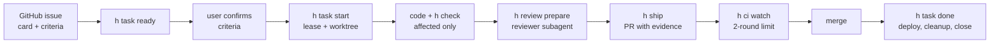

# parallel-agents-harness

**History squashed from a private repo: 310 commits (308 merged PRs) over 18 days,
2026-10-20 → 2026-11-06, versions 0.1.0 → 0.35.0.**

Designed by one developer and built with Claude Code agents working through `h` itself:
it let one person merge about 10 reviewed, CI-green changes a day.

> **Public snapshot of a private working repository**, published as is to show the
> approach and the code. Development continues privately; this copy takes no issues or
> pull requests.

`h` is a command-line tool that lets several AI coding agents (Claude Code sessions) work
on one repository at the same time without stepping on each other, and without the main
session's context filling up with logs. Everything that can be decided by a program is
done by `h`; the agent only does what needs judgment.

It is written in Python with the standard library only, installed with `uv`, and drops
into any GitHub repository with Rust, Python, and/or TypeScript code.

## The problem it solves

With several agents on one codebase, the usual failures are: two sessions take the same
task, every session runs the full test suite on every change, CI repeats the same checks
several times, agents "fix" red CI by weakening tests, and review is skipped when it is
only a rule in a prompt. Agents ignore prose; they do not ignore a red check. So each
rule here is a check, a gate, or a hook, not a sentence in a prompt.

## By the numbers

From the private repository's GitHub data: the 156 merged task PRs (branch `task/*`) of
its 16 days with PRs. The review round is read from the verdict comment `h` posts on each PR.
The other 152 of the 308 PRs: 141 small PRs `h` opens itself to tick a finished task in its
epic file, 4 from Dependabot, and 7 from before the task cycle existed.

| | |
| --- | --- |
| Task PRs merged | 156 in 16 days (about 10 a day), up to 4 open at the same time |
| Approved by the reviewer subagent in round 1 | 79% (105 of 133 reviewed); the rest within 3 rounds |
| Never red in CI | 97% (151 of 156) — `h ship` runs the same `h check` before the push |
| PR opened → merged | median 4 minutes: CI and the merge. The review and the full local check happen before `h ship` opens the PR |
| The harness's own PR CI | about 1 minute, down from 8–10, after Windows became a local gate (ADR-0003) |

## How a task goes



- **Claim.** `h task start` takes a lease on the remote (`refs/claims/<id>`, created
  by a push without force, so exactly one session wins a race), then creates a git
  worktree, ports, and `.env` for the task. A heartbeat keeps the lease; a stale one can
  only be taken over explicitly (ADR-0002).
- **Check.** `h check` runs format, lint, dead code, dependency policy, typecheck, tests,
  and SQL checks only for the packages the change touches, through per-stack adapters
  (cargo/clippy/nextest/deny, ruff/pytest/testmon/deptry, the project's pnpm scripts and
  knip). A machine-wide
  semaphore keeps up to seven parallel sessions from overloading the CPU. A throwaway
  Postgres runs per check when the project needs a database.
- **Ratchet.** Suppressions (`noqa`, `allow`, `eslint-disable`) and skipped tests may only
  go down; `h tether` makes sure every test file is run by some check step.
- **Review gate.** `h review prepare` builds one package (diff, card, relevant ADRs,
  fetched sources) for a reviewer subagent running on a different model from the author.
  `h ship` refuses without its approval; three refusals stop the task until the user
  steps in.
- **Ship.** `h ship` formats, re-runs the check (or reuses a green run on the same HEAD),
  pushes, and opens a PR whose body carries the evidence.
- **CI.** `h init` installs a small `harness.yml` that calls this repository's reusable
  workflow pinned by commit SHA, so CI runs the same `h check` the agent ran locally.
  Heavy steps run after merge. A push to main reuses the merged PR's green check of the
  same tree instead of running it again. `h ci watch` hands a failure log to a `ci-triage`
  subagent and stops after two real failures.
- **After merge.** `h task done` waits for the deploy, removes the worktree and the lease,
  checks the result, and closes the issue. A red main gets `h revert`, a PR the user merges.

Gates that only the user may lift (confirming criteria, resetting the review or CI limit,
discarding work) are denied to the agent in `.claude/settings.json`, and the decisive ones
are required checks on GitHub.

## What `h init` puts into a project

- `AGENTS.md` / `CLAUDE.md`: a short map and the command list for agents
- `.claude/settings.json`: deny rules for unsafe commands and hooks (format on edit,
  guard on write, a task progress ledger that survives context compaction)
- `.claude/agents/`: `locator` (paths only), `analyzer` (facts with file:line),
  `reviewer` (verdict), `ci-triage` (cause of a CI failure)
- `.agents/skills/` mirrored to `.claude/skills/`: `task`, `task-card`, `review-gate`,
  `ci-triage`, `bug-fix`, `research`, `grilling`, `security-rules`, `rust`
- `.github/workflows/harness.yml`: the CI caller, with one required check, `required`
- `harness.toml`: the project describes itself here; everything has a default

## Repository layout

| Path | What |
| --- | --- |
| `harness/` | the `h` package (`harness/src/harness/`) and its tests |
| `harness/src/harness/templates/` | what `h init` installs into a project |
| `polygon/` | a small Rust + Python + TypeScript reference project every change is tested on |
| `.github/workflows/check.yml` | the reusable CI workflow projects pin by SHA |
| `docs/adr/` | architecture decisions |
| `docs/plan.md` | stages and what each one delivered |
| `docs/research/` | notes on how other agent tools and large repositories do this |

The repository checks itself with its own tool: it has a `harness.toml`, and once the
task cycle existed, changes to `h` went through it.

## How large repositories handle the same problems

The rubric below comes from the problems this tool was built for, so it favours this tool.
The four repositories are products with mature human processes, not agent tools; this
compares only the setup an AI agent finds around the code. Read-only subagents assessed
clones on 2026-11-06, with a `file:line` for every claim, and a separate subagent assessed
this tool with the same rubric: [docs/research/agent-readiness.md](docs/research/agent-readiness.md).

Where they are ahead:

- **Test selection and scale.** Sentry picks tests from coverage data and shards them;
  codex has a remote Bazel cache; vllm shards GPU tests by declared file dependencies.
  Here, selection inside a package exists for Python only, and nothing is sharded.
- **Server-side review.** Sentry's AI review runs on GitHub. Here the reviewer is a local
  subagent whose verdict the author's own account posts, so the gate stops accidents,
  not someone set on going around it.
- **Supply chain and ratchets.** Supabase holds new packages for 72 hours and opens weekly
  PRs that lower its lint baselines; this tool's ratchet refuses growth, and lowering
  the baseline is a manual `h ratchet --update`.

✓ in place · ◐ partly · ✗ not found

| | this harness | openai/codex | getsentry/sentry | supabase/supabase | vllm-project/vllm |
| --- | --- | --- | --- | --- | --- |
| Agent instructions checked by tools | ✓ size, links, frontmatter, config names | ✗ no root AGENTS.md | ✗ layered, unchecked | ✗ layered, unchecked | ✓ pre-commit: size, links, symlinks |
| Two agents cannot take one task | ✓ lease on origin, one winner | ✗ | ✗ | ✗ | ◐ prose: search for a duplicate PR first |
| Isolation of parallel sessions | ✓ worktree, ports, Postgres per check, CPU budget | ◐ `.worktreeinclude` | ◐ worktrees ignored, ports by env | ✗ fixed ports | ✗ one venv, shared build |
| Checks scoped to the change | ✓ affected packages, testmon locally, docs-only skip | ✓ changed-files job, Bazel cache | ✓ tests chosen by coverage, shards | ◐ Studio only | ✓ per-step file dependencies, shards |
| Rules enforced by tools | ✓ ratchet, tether, dead code, deny | ✓ clippy deny, boundary scripts | ✓ hooks, mypy ratchet | ✓ lint ratchet, knip, zizmor | ✓ custom hooks, test tethering |
| Review gate | ✓ second model, ship refuses without approve | ◐ CODEOWNERS on core paths | ✓ AI review (Warden) on PRs | ◐ Copilot policy, CODEOWNERS | ◐ CODEOWNERS, `ready` label |
| One required check, PR / post-merge tiers | ✓ `required`, heavy after merge | ✓ `CI required`, post-merge CI | ✓ aggregate per area | ◐ no aggregate found | ◐ Buildkite, no aggregate found |
| A red main | ✓ regression issue + revert PR | ✗ | ✓ revert bot | ◐ Slack alert | ◐ failure report, bisect docs |
| Reusable in another repository | ✓ `h init` | ✗ bespoke | ◐ bespoke; skills and Warden are separate repos | ✗ bespoke | ✗ bespoke |

## Known limits

- Built for one developer's machine (Windows, many cores) with projects on Ubuntu CI;
  macOS was never tested, and cloud agent sessions are not supported.
- GitHub and Claude Code only: other agents get `AGENTS.md` and the skills, but not the
  hooks or the deny rules.
- Tried on this repository and one pilot project, over 18 days.
- Not built: task metrics (`h metrics` — the numbers above come from the GitHub API),
  zizmor in the check, a clean-worktree check after CI.

## Trying it

Requirements: Python 3.11+, [uv](https://docs.astral.sh/uv/), git, an authenticated
[GitHub CLI](https://cli.github.com/), and Claude Code. Developed on Windows, with CI on
Ubuntu; macOS was never tested.

```sh
uv tool install "git+https://github.com/wideGenesis/parallel-agents-harness#subdirectory=harness"
cd your-project
h doctor          # which tools are missing
h init            # AGENTS.md, CLAUDE.md, .claude/, harness.yml, harness.toml
h check           # what CI will run
```

Running the tool's own tests:

```sh
cd harness
uv run pytest -q
uv run h -C ../polygon doctor
```

## License

[MIT](LICENSE)
